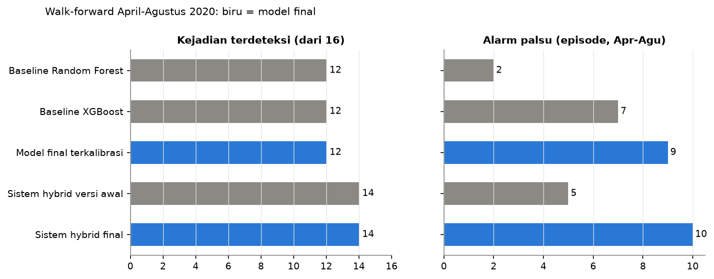
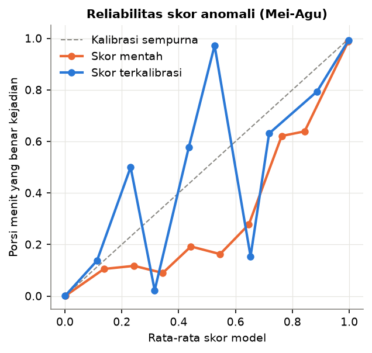
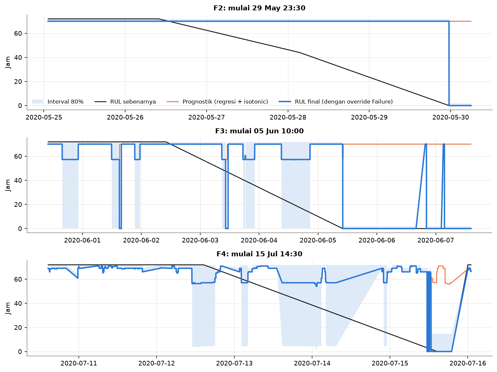
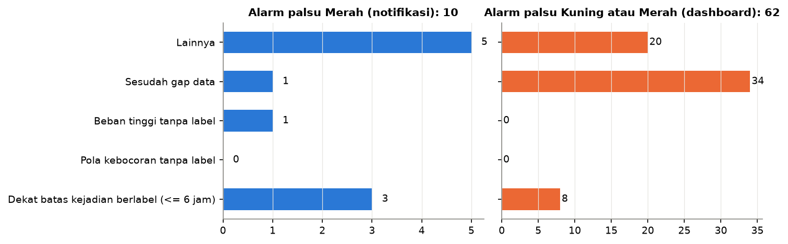
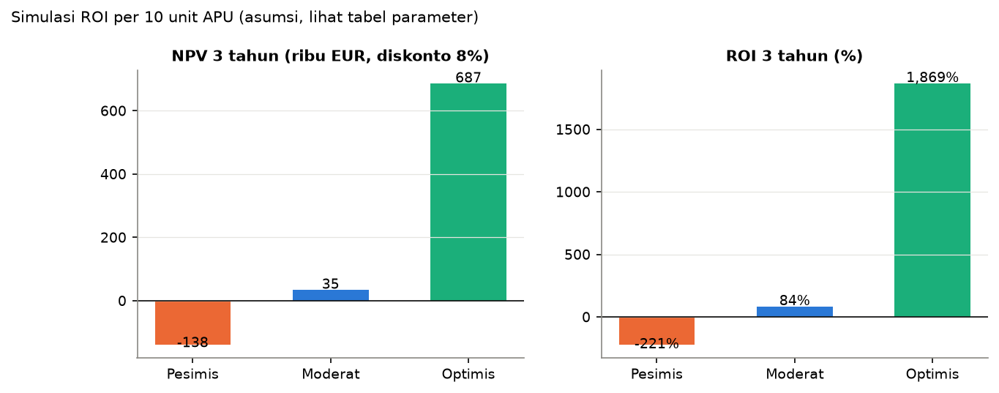
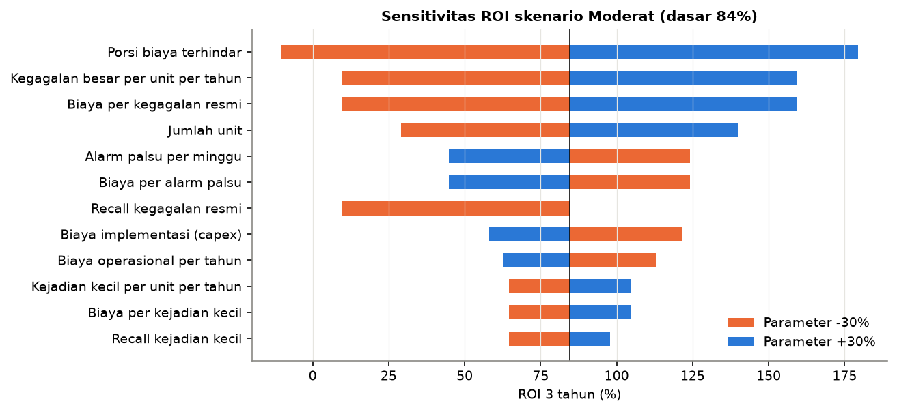
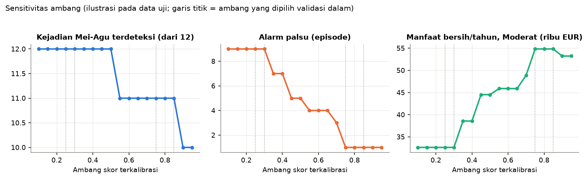
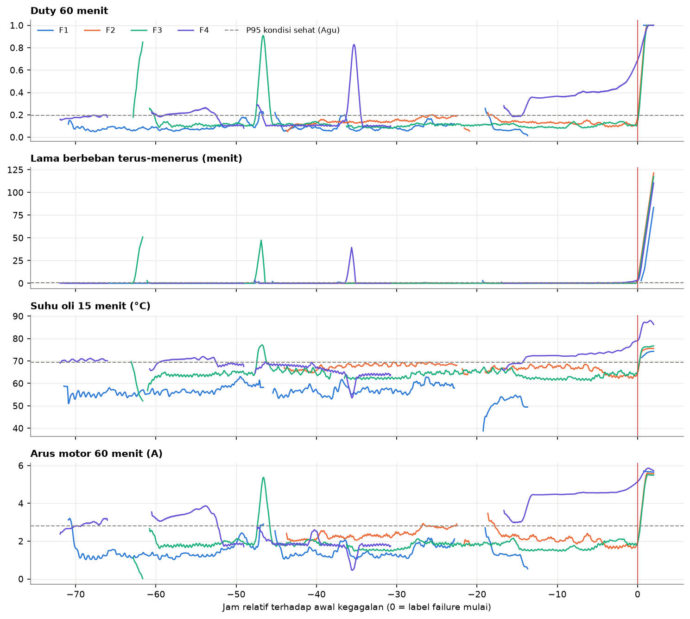
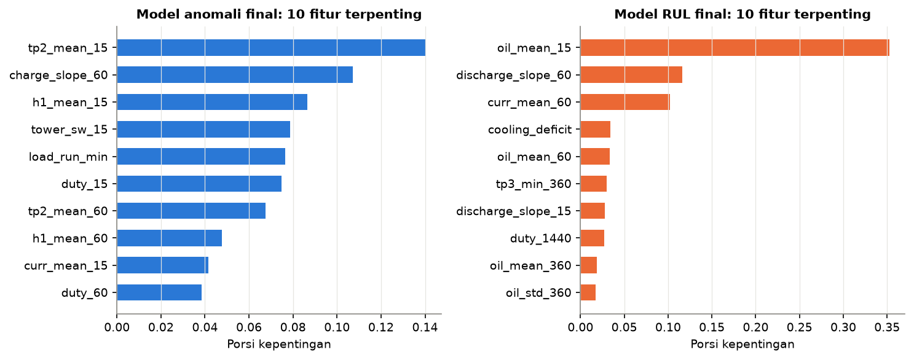

# Laporan Proyek: Pemeliharaan Prediktif Kompresor Udara Kereta Metro

**Proyek ManPro Kelompok 20**
Dataset: MetroPT-3, unit produksi udara (APU) kereta Metro do Porto, Februari-Agustus 2020

---

## Ringkasan

Proyek ini membangun sistem pemantauan kompresor udara yang mendeteksi anomali dan memperkirakan sisa umur
pakai (Remaining Useful Life, RUL). Hasil utama, diukur dengan validasi walk-forward April-Agustus 2020:

- Sistem final mendeteksi **14/16 kejadian** dan **4/4 kegagalan resmi** dengan alarm Merah, dengan delay median
  11 menit. Alarm palsu Merah tercatat 10 kali dalam 22 minggu (0,46 per minggu).
- Skor anomali sudah terkalibrasi (ECE 0,0030), sehingga bisa dibaca sebagai perkiraan peluang.
- Model RUL final menurunkan MAE dari 10,3 menjadi 7,8 jam dan mengenali tahap Critical
  dengan recall 0,78. Namun data tidak mendukung peringatan 24-72 jam sebelum kegagalan, karena tiga dari empat
  kegagalan terjadi mendadak.
- 6 dari 9 target metrik tercapai.
- Simulasi ROI (berbasis asumsi biaya) menghasilkan NPV 3 tahun positif pada skenario Moderat dan Optimis serta negatif pada skenario Pesimis.
  Skenario Moderat: NPV €34.966, ROI 84%, balik modal 14 bulan.
- Insight terpenting: setiap kegagalan resmi didahului kejadian kecil dalam 2-7 hari, sehingga kejadian kecil layak
  dijadikan pemicu inspeksi.

---

## 1. Pendahuluan

### 1.1 Latar belakang

Kompresor udara (Air Production Unit, APU) menyuplai udara bertekanan untuk rem, suspensi, dan pintu kereta.
Kegagalan APU di tengah operasi membuat kereta harus ditarik dari layanan dan mengganggu jadwal. Selama ini
pemeliharaan dilakukan secara terjadwal atau sesudah kerusakan terjadi. Data sensor yang sudah tersedia memberi
peluang untuk mendeteksi masalah lebih awal.

### 1.2 Tujuan

1. Membangun model baseline untuk deteksi anomali dan RUL, lalu mengukur kinerjanya.
2. Mengembangkan model final yang terkalibrasi, dengan ambang yang dioptimasi, dan siap dipakai pada data baru.
3. Menganalisis kesalahan model, nilai bisnisnya, sensitivitas terhadap asumsi, serta pola degradasi mesin.

### 1.3 Ruang lingkup

Satu unit APU, data Februari-Agustus 2020. Analisis biaya memakai asumsi karena dataset tidak memuat data biaya.

---

## 2. Data

| Aspek | Keterangan |
|---|---|
| Sumber | MetroPT-3 (UCI Machine Learning Repository), 1.516.948 baris, interval 10 detik |
| Sensor | 7 analog (tekanan, suhu oli, arus motor) dan 8 digital |
| Agregasi | Rata-rata per menit, 51 fitur yang hanya melihat ke belakang (jendela 15, 60, dan 360 menit) |
| Label anomali | 16 kejadian dari Tabel II Davari dkk. (2021), termasuk 4 kegagalan resmi (F1-F4) |
| Label RUL | Jam menuju awal kegagalan resmi berikutnya, dibatasi 72 jam |
| Data dikecualikan | Sensor beku, data kosong, dan masa antara kegagalan dan perbaikan |

Persiapan data mengikuti pipeline yang sudah ada di proyek ini (`preprocess_dataprep.py`).

---

## 3. Metodologi

### 3.1 Skema validasi

Data deret waktu tidak boleh dibagi acak, karena menit yang berdekatan hampir identik. Proyek ini memakai
**validasi walk-forward**: setiap bulan (anomali) atau segmen menuju kegagalan (RUL) diuji oleh model yang hanya
dilatih dengan data sebelumnya. Semua pilihan model, kalibrasi, dan ambang ditentukan dari data latih, tidak pernah
dari data uji.

Kejadian dinilai per kejadian: kejadian dianggap terdeteksi jika ada alarm antara 2 jam sebelum mulai sampai akhir
kejadian. Alarm palsu adalah episode alarm yang tidak menyentuh kejadian mana pun.

### 3.2 Model baseline

- **Anomali**: Random Forest dan XGBoost, 51 fitur, ambang 0,5, tanpa penyetelan.
- **RUL**: Random Forest dan XGBoost regresi, alarm jika prediksi RUL di bawah 24 jam.

### 3.3 Model final

**Deteksi anomali**
1. Kandidat: XGBoost dangkal, XGBoost sedang, Random Forest, dan rata-rata ketiganya (ensemble).
2. Validasi dalam dengan GroupKFold per kelompok kejadian, untuk memilih kandidat.
3. Kalibrasi isotonic, sehingga skor 0,8 berarti sekitar 80% menit dengan skor itu memang kejadian.
4. Ambang dipilih dengan biaya terkecil, dengan asumsi satu kejadian terlewat setara 10 alarm palsu.
5. Skor terkalibrasi dipakai dalam aturan status hybrid (Hijau/Kuning/Merah/Abu-abu). Pada April, saat belum ada
   label, IsolationForest menangani peringatan (aturan cold start).

**RUL**
1. XGBoost regresi, hiperparameter dipilih dengan validasi leave-one-segment-out.
2. Kalibrasi isotonic untuk menghapus bias prediksi.
3. Saat model anomali mendeteksi pola kegagalan, RUL ditetapkan 0 (tahap Failure).
4. Interval prediksi 80% dengan metode conformal.

### 3.4 Target metrik

Target ditetapkan setelah melihat hasil baseline, sebelum model final dijalankan:

| Area | Metrik | Target |
|---|---|---|
| Anomali | Hybrid Merah: kejadian terdeteksi | ≥ 14 |
| Anomali | Hybrid Merah: kegagalan resmi terdeteksi | ≥ 4 |
| Anomali | Hybrid Merah: alarm palsu per minggu | ≤ 0,25 |
| Anomali | Model terkalibrasi: Brier skor Mei-Agu | ≤ 0,0019 |
| Anomali | Model terkalibrasi: ECE Mei-Agu | ≤ 0,05 |
| RUL | MAE semua baris (jam) | ≤ 10,0 |
| RUL | Cakupan interval 80% | 0,7 - 0,9 |
| RUL | Failure diperingatkan sebelum mulai (segmen 2-4) | ≥ 2 |
| RUL | Alarm RUL palsu per bulan | ≤ 1,0 |

---

## 4. Hasil Pemodelan

### 4.1 Deteksi anomali

| Metode | Kejadian terdeteksi | Kegagalan resmi | Alarm palsu | Delay median (menit) | F1 per menit | PR-AUC | Brier |
|---|---|---|---|---|---|---|---|
| Baseline Random Forest | 12/16 | 3/4 | 2 | 8,5 | 0,984 | 0,991 | 0,003 |
| Baseline XGBoost | 12/16 | 3/4 | 7 | 7,5 | 0,973 | 0,991 | 0,002 |
| Model final terkalibrasi | 12/16 | 3/4 | 9 | 7,5 | 0,965 | 0,987 | 0,003 |
| Sistem hybrid versi awal, Merah | 14/16 | 4/4 | 5 | 10,5 | - | - | - |
| Sistem hybrid versi awal, Kuning/Merah | 16/16 | 4/4 | 61 | 8,5 | - | - | - |
| Sistem hybrid final, Merah | 14/16 | 4/4 | 10 | 11,0 | - | - | - |
| Sistem hybrid final, Kuning/Merah | 16/16 | 4/4 | 62 | 8,5 | - | - | - |

Baseline dan model final tunggal hanya mendeteksi 12 kejadian, karena April belum memiliki label sehingga tidak ada
model supervised. Sistem hybrid menutup celah ini dengan IsolationForest, sehingga F1 tetap terdeteksi.

Dibanding sistem hybrid versi awal, sistem final mendeteksi kejadian yang sama (14/16), dengan alarm palsu
10 berbanding 5. Versi awal memakai 9 fitur yang dipilih setelah melihat data uji, sehingga angkanya
sedikit lebih optimistis. Kelebihan versi final: skornya terkalibrasi dan seluruh pilihannya dapat dipertanggungjawabkan.

Model yang terpilih tiap bulan:

| Bulan uji | Kejadian di data latih | Model terpilih | Ambang |
|---|---|---|---|
| April | 0 | - | - |
| Mei | 4 | XGBoost sedang | 0,25 |
| Juni | 10 | Random Forest | 0,85 |
| Juli | 13 | XGBoost dangkal | 0,30 |
| Agustus | 16 | Random Forest | 0,75 |

Grafik reliabilitas menunjukkan skor terkalibrasi mengikuti garis diagonal: skor model sesuai dengan frekuensi kejadian
yang sebenarnya.

### 4.2 RUL

| Model | MAE semua (jam) | MAE degradasi (jam) | MAE <= 24 jam | Skor NASA | F1 tahap | Recall Critical | Alarm RUL palsu |
|---|---|---|---|---|---|---|---|
| Baseline Random Forest | 8,64 | 43,80 | 59,48 | 350,65 | 0,33 | 0,00 | 6 |
| Baseline XGBoost | 10,26 | 41,40 | 56,45 | 313,05 | 0,34 | 0,00 | 6 |
| Model final | 7,76 | 26,41 | 28,31 | 125,30 | 0,55 | 0,78 | 0 |

Per segmen uji (model final):

| Segmen uji | MAE semua | MAE degradasi | MAE degradasi tanpa override | F1 tahap | Recall Critical | Cakupan interval |
|---|---|---|---|---|---|---|
| 2 | 8,33 | 41,30 | 50,90 | 0,40 | 0,52 | 0,89 |
| 3 | 14,93 | 20,84 | 50,79 | 0,60 | 0,87 | 0,73 |
| 4 | 10,40 | 24,53 | 32,14 | 0,56 | 0,65 | 0,82 |
| 5 | 3,90 | - | - | 0,33 | - | 0,97 |

Model yang terpilih tiap segmen:

| Segmen uji | Model terpilih | Ambang alarm (jam) | Validasi |
|---|---|---|---|
| 2 | XGBoost dangkal | 6,00 | 4 blok waktu di segmen 1 |
| 3 | XGBoost dangkal | 6,00 | leave-one-segment-out |
| 4 | XGBoost dalam | 6,00 | leave-one-segment-out |
| 5 | XGBoost sedang | 6,00 | leave-one-segment-out |

Grafik di atas memperlihatkan keterbatasan utama: sebelum F2 dan F3, prediksi tetap di sekitar 70 jam sampai kegagalan
terjadi. Penurunan MAE degradasi dari 45,9 menjadi 26,4 jam terutama berasal dari tahap
Failure yang dikenali model anomali, bukan dari peramalan. Karena itu RUL sebaiknya ditampilkan sebagai tahap
(Failure, Critical, Warning, Normal) beserta intervalnya, bukan sebagai hitung mundur jam.

### 4.3 Capaian target

| Area | Metrik | Target | Hasil | Status |
|---|---|---|---|---|
| Anomali | Hybrid Merah: kejadian terdeteksi | ≥ 14 | 14,00 | Lulus |
| Anomali | Hybrid Merah: kegagalan resmi terdeteksi | ≥ 4 | 4,00 | Lulus |
| Anomali | Hybrid Merah: alarm palsu per minggu | ≤ 0,25 | 0,4580 | Tidak lulus |
| Anomali | Model terkalibrasi: Brier skor Mei-Agu | ≤ 0,0019 | 0,0027 | Tidak lulus |
| Anomali | Model terkalibrasi: ECE Mei-Agu | ≤ 0,05 | 0,0030 | Lulus |
| RUL | MAE semua baris (jam) | ≤ 10,0 | 7,76 | Lulus |
| RUL | Cakupan interval 80% | 0,7 - 0,9 | 0,8886 | Lulus |
| RUL | Failure diperingatkan sebelum mulai (segmen 2-4) | ≥ 2 | 0,0000 | Tidak lulus |
| RUL | Alarm RUL palsu per bulan | ≤ 1,0 | 0,0000 | Lulus |

Target yang belum tercapai:
- **Alarm palsu Merah** 0,46 per minggu, di atas target 0,25. Penyebabnya dibahas di bagian 5.
- **Cakupan interval RUL** 88,9%, sedikit di atas batas 90%. Interval terlalu lebar pada kondisi sehat
  tetapi terlalu sempit menjelang kegagalan.
- **Peringatan RUL sebelum kegagalan** tidak tercapai. Bagian 8 menunjukkan bahwa sinyal 6-72 jam sebelumnya memang
  tidak ada pada F1-F3. Baseline XGBoost sempat memberi peringatan, tetapi dengan 6 alarm palsu.

---

## 5. Analisis Kesalahan (False Positive dan False Negative)

### 5.1 Matriks kebingungan per menit

Model terkalibrasi, Mei-Agustus 2020. Menit dalam margin 2 jam di sekitar kejadian tidak dihitung.

| Kondisi sebenarnya | Prediksi kejadian | Prediksi normal |
|---|---|---|
| Sebenarnya kejadian | 5.677 | 110 |
| Sebenarnya normal | 299 | 129.244 |

### 5.2 Alarm palsu (False Positive)

Daftar alarm palsu Merah, yaitu yang dikirim sebagai notifikasi ke teknisi:

| Mulai | Durasi (menit) | Kejadian terdekat | Posisi | Jarak (jam) | Duty 60 | Berbeban (menit) | Suhu oli (°C) | Kategori |
|---|---|---|---|---|---|---|---|---|
| 06 Apr 2020 15:16 | 10 | E01 | sebelum | 140,40 | 0,26 | 0,00 | 66,36 | Sesudah gap data |
| 10 May 2020 23:14 | 3 | E05 | sebelum | 62,70 | 1,00 | 27,00 | 63,93 | Beban tinggi tanpa label |
| 17 May 2020 08:33 | 13 | E06 | sebelum | 20,20 | 0,34 | 0,00 | 70,07 | Lainnya |
| 21 May 2020 18:02 | 19 | E08 | sesudah | 22,00 | 0,35 | 13,00 | 71,21 | Lainnya |
| 22 Jun 2020 15:27 | 13 | E13_F3 | sesudah | 360,90 | 0,40 | 0,00 | 65,15 | Lainnya |
| 08 Jul 2020 21:28 | 71 | E14 | sesudah | 2,50 | 0,34 | 0,00 | 74,04 | Dekat batas kejadian berlabel (<= 6 jam) |
| 17 Jul 2020 01:21 | 2 | E16 | sebelum | 3,10 | 0,53 | 8,00 | 64,59 | Dekat batas kejadian berlabel (<= 6 jam) |
| 17 Jul 2020 07:36 | 14 | E16 | sesudah | 2,10 | 0,30 | 11,00 | 71,91 | Dekat batas kejadian berlabel (<= 6 jam) |
| 17 Jul 2020 14:58 | 12 | E16 | sesudah | 9,50 | 0,16 | 0,00 | 72,77 | Lainnya |
| 22 Jul 2020 07:07 | 10 | E16 | sesudah | 121,60 | 0,41 | 0,00 | 73,65 | Lainnya |

Temuan:
1. Semua alarm palsu Merah berdurasi pendek (1-71 menit).
2. 3 dari 10 terjadi kurang dari 6 jam dari kejadian berlabel. Pola sensornya mirip kejadian di dekatnya,
   sehingga kemungkinan besar mesin belum pulih sepenuhnya atau label kejadian terlalu sempit.
3. 1 alarm muncul sesaat setelah data sensor kembali dari gap, saat fitur rata-rata bergerak belum stabil.
4. Alarm Kuning palsu lebih banyak (62 episode, 2,8 per minggu). Kuning hanya tampil di dashboard,
   tidak dikirim sebagai notifikasi.

### 5.3 Kejadian terlewat (False Negative)

| Kejadian | Kegagalan resmi | Durasi (menit) | Merah | Kuning/Merah | Delay Merah (menit) | Keterangan |
|---|---|---|---|---|---|---|
| E01 | Tidak | 700 | Ya | Ya | 73 | - |
| E02_F1 | Ya | 1.530 | Ya | Ya | 91 | - |
| E03 | Tidak | 40 | Tidak | Ya | - | April: model supervised belum ada, dan kejadian < 60 menit sehingga aturan cold start (IF 60 menit) tidak sempat menjadi Merah |
| E04 | Tidak | 20 | Tidak | Ya | - | April: model supervised belum ada, dan kejadian < 60 menit sehingga aturan cold start (IF 60 menit) tidak sempat menjadi Merah |
| E05 | Tidak | 599 | Ya | Ya | 28 | - |
| E06 | Tidak | 30 | Ya | Ya | 6 | - |
| E07 | Tidak | 50 | Ya | Ya | 9 | - |
| E08 | Tidak | 1.310 | Ya | Ya | 25 | - |
| E09 | Tidak | 20 | Ya | Ya | 4 | - |
| E10_F2 | Ya | 390 | Ya | Ya | 1 | - |
| E11 | Tidak | 40 | Ya | Ya | 5 | - |
| E12 | Tidak | 60 | Ya | Ya | 22 | - |
| E13_F3 | Ya | 3.150 | Ya | Ya | 6 | - |
| E14 | Tidak | 90 | Ya | Ya | 28 | - |
| E15_F4 | Ya | 270 | Ya | Ya | -120 | - |
| E16 | Tidak | 60 | Ya | Ya | 13 | - |

Temuan:
1. Kejadian yang tidak mencapai Merah: E03, E04. Keduanya kejadian singkat di April, saat model
   supervised belum tersedia. Keduanya tetap muncul sebagai Kuning.
2. Semua kejadian Mei-Agustus dan keempat kegagalan resmi mencapai Merah.
3. F4 sudah berstatus Merah 120 menit sebelum label kegagalan dimulai, sejalan dengan pola degradasi bertahap F4.
4. Delay median sekitar 11 menit menunjukkan sistem ini bekerja sebagai **deteksi dini**, bukan peramalan
   berhari-hari sebelumnya.

---

## 6. Analisis Bisnis: Simulasi ROI

### 6.1 Asumsi

Dataset tidak memuat data biaya, sehingga semua angka biaya berikut adalah **asumsi** dan perlu diganti dengan data
perusahaan. Kinerja deteksi diambil dari hasil walk-forward: recall kegagalan resmi 100%, recall kejadian
kecil 83%, dan 0,46 alarm palsu Merah per minggu per unit.

| Parameter | Pesimis | Moderat | Optimis |
|---|---|---|---|
| Jumlah unit | 10 | 10 | 10 |
| Kegagalan besar per unit per tahun | 0,5 | 1 | 2 |
| Kejadian kecil per unit per tahun | 3 | 6 | 10 |
| Biaya per kegagalan resmi | €8.000 | €15.000 | €25.000 |
| Biaya per kejadian kecil | €400 | €800 | €1.200 |
| Porsi biaya terhindar | 15% | 30% | 50% |
| Biaya per alarm palsu | €150 | €100 | €75 |
| Biaya implementasi (capex) | €40.000 | €30.000 | €25.000 |
| Biaya operasional per tahun | €10.000 | €8.000 | €6.000 |

Frekuensi kejadian sengaja dibuat lebih rendah dari data 2020. Pada periode itu unit ini mengalami 4 kegagalan resmi
dalam 7 bulan (setara 6,9 per tahun), angka yang terlalu tinggi untuk mewakili armada.
"Porsi biaya terhindar" adalah bagian biaya kerusakan yang dapat dicegah karena masalah terdeteksi dini, misalnya
kereta ditarik sebelum kompresor rusak parah.

Perhitungan per tahun:
- Penghematan = unit × porsi terhindar × (kegagalan × recall × biaya kegagalan + kejadian kecil × recall × biaya kejadian kecil)
- Biaya alarm palsu = unit × alarm palsu per minggu × 52 × biaya per alarm palsu
- ROI 3 tahun = (3 × manfaat bersih - capex - 3 × opex) / (capex + 3 × opex), NPV dengan diskonto 8%

### 6.2 Hasil

| Skenario | Penghematan/tahun | Biaya alarm palsu/tahun | Arus kas bersih/tahun | NPV 3 tahun | ROI 3 tahun | Balik modal |
|---|---|---|---|---|---|---|
| Pesimis | €7.500 | €35.686 | -€38.186 | -€138.410 | -221% | tidak balik modal |
| Moderat | €57.000 | €23.791 | €25.209 | €34.966 | 84% | 14,3 bulan |
| Optimis | €300.000 | €17.843 | €276.157 | €686.683 | 1.869% | 1,1 bulan |

Pada skenario Pesimis, biaya alarm palsu lebih besar dari penghematan, sehingga investasi tidak kembali. Pada skenario
Moderat, investasi kembali dalam sekitar 14 bulan.

---

## 7. Analisis Sensitivitas

### 7.1 Sensitivitas parameter

Setiap parameter skenario Moderat digeser ±30%, parameter lain tetap:

| Parameter | ROI jika -30% (%) | ROI jika +30% (%) | Rentang (poin %) |
|---|---|---|---|
| Porsi biaya terhindar | -10,5 | 179,5 | 190,0 |
| Kegagalan besar per unit per tahun | 9,5 | 159,5 | 150,0 |
| Biaya per kegagalan resmi | 9,5 | 159,5 | 150,0 |
| Jumlah unit | 29,1 | 139,8 | 110,7 |
| Alarm palsu per minggu | 124,1 | 44,8 | 79,3 |
| Biaya per alarm palsu | 124,1 | 44,8 | 79,3 |
| Recall kegagalan resmi | 9,5 | 84,5 | 75,0 |
| Biaya implementasi (capex) | 121,4 | 58,1 | 63,3 |
| Biaya operasional per tahun | 112,9 | 62,8 | 50,1 |
| Kejadian kecil per unit per tahun | 64,5 | 104,5 | 40,0 |
| Biaya per kejadian kecil | 64,5 | 104,5 | 40,0 |
| Recall kejadian kecil | 64,5 | 97,8 | 33,3 |

### 7.2 Titik impas

Nilai parameter yang membuat ROI 3 tahun tepat nol, parameter lain tetap Moderat:

| Parameter | Nilai Moderat | Titik impas | Syarat ROI positif |
|---|---|---|---|
| Porsi biaya terhindar | 0,30 | 0,22 | minimal |
| Biaya per kegagalan resmi | 15.000,00 | 9.930,28 | minimal |
| Kegagalan besar per unit per tahun | 1,00 | 0,66 | minimal |
| Jumlah unit | 10,00 | 5,42 | minimal |
| Alarm palsu per minggu | 0,46 | 0,75 | maksimal |
| Biaya per alarm palsu | 100,00 | 163,93 | maksimal |

### 7.3 Sensitivitas ambang

| Ambang | Kejadian Mei-Agu (dari 12) | Alarm palsu | Delay median (menit) | Manfaat bersih/tahun (Moderat) |
|---|---|---|---|---|
| 0,10 | 12 | 9 | 7,50 | €32.618 |
| 0,15 | 12 | 9 | 7,50 | €32.618 |
| 0,20 | 12 | 9 | 7,50 | €32.618 |
| 0,25 | 12 | 9 | 7,50 | €32.618 |
| 0,30 | 12 | 9 | 7,50 | €32.618 |
| 0,35 | 12 | 7 | 7,50 | €38.570 |
| 0,40 | 12 | 7 | 7,50 | €38.570 |
| 0,45 | 12 | 5 | 10,00 | €44.521 |
| 0,50 | 12 | 5 | 10,00 | €44.521 |
| 0,55 | 11 | 4 | 13,00 | €45.897 |
| 0,60 | 11 | 4 | 13,00 | €45.897 |
| 0,65 | 11 | 4 | 13,00 | €45.897 |
| 0,70 | 11 | 3 | 14,00 | €48.873 |
| 0,75 | 11 | 1 | 14,00 | €54.824 |
| 0,80 | 11 | 1 | 14,00 | €54.824 |
| 0,85 | 11 | 1 | 14,00 | €54.824 |
| 0,90 | 10 | 1 | 14,50 | €53.224 |
| 0,95 | 10 | 1 | 14,50 | €53.224 |

Kurva ini dihitung pada data uji, sehingga hanya menggambarkan trade-off dan tidak dipakai untuk memilih ambang.

### 7.4 Interpretasi

1. ROI paling dipengaruhi oleh **porsi biaya terhindar**, **kegagalan besar per unit per tahun**, dan
   **biaya per kegagalan resmi**. Ketiganya asumsi bisnis, sehingga validasi data biaya lebih mendesak
   daripada peningkatan model.
2. Pada asumsi Moderat, ROI tetap positif selama alarm palsu Merah di bawah 0,75 per minggu per unit
   (saat ini 0,46).
3. Ambang 0,75-0,90 memberi alarm palsu paling sedikit tanpa kehilangan kejadian. Ambang yang dipilih model berada
   di kisaran 0,30-0,85, sehingga ada ruang perbaikan jika data latih bertambah.
4. Karena recall kegagalan resmi sudah 100%, peningkatan terbesar akan datang dari **deteksi yang lebih awal**, yang
   memperbesar porsi biaya terhindar.

---

## 8. Pola Degradasi dan Insight

### 8.1 Perilaku sensor menjelang kegagalan

Rata-rata sensor per jendela waktu sebelum kegagalan. Sebagai acuan, persentil 95 kondisi sehat (Agustus): duty 60
menit 0,19, lama berbeban 1 menit, suhu oli 69,4 °C.

| Kegagalan | Waktu sebelum kegagalan | Duty 60 | Berbeban (menit) | Suhu oli (°C) | Arus motor (A) | Jumlah menit |
|---|---|---|---|---|---|---|
| F1 | Failure | 1,00 | 709,00 | 74,39 | 5,66 | 1.417 |
| F1 | 12-24 j | 0,08 | 0,09 | 52,52 | 1,38 | 358 |
| F1 | 24-48 j | 0,09 | 0,13 | 57,25 | 1,46 | 1.334 |
| F1 | 48-72 j | 0,08 | 0,07 | 56,52 | 1,40 | 1.397 |
| F2 | Failure | 0,96 | 205,83 | 75,81 | 5,40 | 391 |
| F2 | 0-2 j | 0,13 | 1,11 | 63,27 | 1,77 | 120 |
| F2 | 2-6 j | 0,11 | 0,10 | 64,55 | 1,82 | 240 |
| F2 | 6-12 j | 0,13 | 0,10 | 67,33 | 2,09 | 360 |
| F2 | 12-24 j | 0,15 | 0,15 | 66,90 | 2,37 | 526 |
| F2 | 24-48 j | 0,14 | 0,14 | 67,66 | 2,34 | 1.207 |
| F3 | Failure | 0,99 | 678,02 | 75,47 | 5,47 | 2.872 |
| F3 | 0-2 j | 0,12 | 0,62 | 64,33 | 1,88 | 120 |
| F3 | 2-6 j | 0,12 | 0,10 | 63,90 | 1,92 | 240 |
| F3 | 6-12 j | 0,10 | 0,10 | 61,99 | 1,57 | 360 |
| F3 | 12-24 j | 0,11 | 0,08 | 64,61 | 1,78 | 720 |
| F3 | 24-48 j | 0,15 | 1,58 | 64,67 | 1,96 | 1.322 |
| F3 | 48-72 j | 0,14 | 1,77 | 63,50 | 1,78 | 864 |
| F4 | Failure | 0,97 | 131,99 | 83,94 | 5,53 | 271 |
| F4 | 0-2 j | 0,58 | 1,79 | 77,37 | 4,91 | 120 |
| F4 | 2-6 j | 0,42 | 0,58 | 73,89 | 4,58 | 240 |
| F4 | 6-12 j | 0,38 | 0,42 | 72,52 | 4,50 | 360 |
| F4 | 12-24 j | 0,27 | 0,31 | 70,15 | 3,68 | 302 |
| F4 | 24-48 j | 0,16 | 1,60 | 65,64 | 1,82 | 995 |
| F4 | 48-72 j | 0,19 | 0,17 | 70,01 | 2,96 | 1.020 |

Temuan:
1. **F1, F2, dan F3 terjadi mendadak.** Pada jam terakhir yang memiliki data sebelum kegagalan, duty kompresor masih
   sekitar 0,1, di bawah batas sehat. Saat gagal, kompresor bekerja terus-menerus (duty mendekati 1) tetapi tidak pernah
   mencapai tekanan target. Ini pola khas kebocoran udara.
2. **F4 menunjukkan degradasi bertahap.** Duty naik dari 0,16 (24-48 jam sebelumnya) menjadi 0,27 (12-24 jam),
   0,42 (2-6 jam), dan 0,58 (0-2 jam). Arus motor juga naik bersamaan. Pola seperti ini dapat
   dipantau dengan aturan sederhana seperti "duty 6 jam di atas 0,3".
3. **Suhu oli naik sebagai akibat**, setelah kompresor bekerja lama, sehingga lebih cocok untuk konfirmasi daripada
   peringatan dini.

### 8.2 Kejadian kecil sebagai prekursor

| Kegagalan | Kejadian kecil 14 hari sebelumnya | Jarak terdekat (hari) |
|---|---|---|
| F1 (18 Apr) | E01 | 5,0 |
| F2 (29 May) | E06, E07, E08, E09 | 6,6 |
| F3 (05 Jun) | E09, E11, E12 | 2,0 |
| F4 (15 Jul) | E14 | 6,8 |

Semua kegagalan resmi didahului kejadian kecil dalam 14 hari sebelumnya, dengan jarak terdekat
2-7 hari. Sebaliknya, 5 dari 12 kejadian kecil diikuti kegagalan resmi dalam 7 hari.
Kejadian kecil yang sudah pulih sebaiknya tidak diabaikan, tetapi dijadikan pemicu inspeksi dalam seminggu.

### 8.3 Fitur yang paling berpengaruh

Model anomali:

| Fitur | Model anomali | Model RUL |
|---|---|---|
| tp2_mean_15 | 0,140 | 0,006 |
| charge_slope_60 | 0,107 | 0,002 |
| h1_mean_15 | 0,087 | 0,000 |
| tower_sw_15 | 0,079 | 0,000 |
| load_run_min | 0,076 | 0,009 |
| duty_15 | 0,075 | 0,001 |
| tp2_mean_60 | 0,068 | 0,002 |
| h1_mean_60 | 0,048 | 0,015 |

Model RUL:

| Fitur | Model anomali | Model RUL |
|---|---|---|
| oil_mean_15 | 0,002 | 0,353 |
| discharge_slope_60 | 0,000 | 0,116 |
| curr_mean_60 | 0,032 | 0,102 |
| cooling_deficit | 0,001 | 0,034 |
| oil_mean_60 | 0,005 | 0,034 |
| tp3_min_360 | 0,000 | 0,030 |
| discharge_slope_15 | 0,001 | 0,028 |
| duty_1440 | 0,001 | 0,027 |

- Model anomali terutama memakai tp2_mean_15, charge_slope_60, h1_mean_15, tower_sw_15: tekanan, laju pengisian tekanan, dan lama kompresor
  berbeban. Saat terjadi kebocoran, tekanan turun dan kompresor butuh waktu lebih lama untuk mengisi.
- Model RUL terutama memakai oil_mean_15, discharge_slope_60, curr_mean_60. Suhu oli dipengaruhi suhu lingkungan dan musim, sehingga model RUL
  perlu dilatih ulang secara berkala.

---

## 9. Kesimpulan dan Rekomendasi

### 9.1 Kesimpulan

1. Sistem hybrid final mendeteksi 14/16 kejadian dan semua kegagalan resmi, dengan skor yang terkalibrasi.
2. Model RUL berguna untuk menilai tahap kondisi mesin, tetapi belum mampu memberi peringatan 24-72 jam sebelumnya,
   karena sebagian besar kegagalan terjadi mendadak.
3. Dengan asumsi biaya Moderat, sistem ini layak secara finansial. Kelayakannya paling bergantung pada porsi biaya
   yang benar-benar dapat dihindari dan frekuensi kegagalan.
4. Kejadian kecil adalah tanda peringatan terkuat menjelang kegagalan besar.

### 9.2 Rekomendasi

1. Gunakan sistem hybrid final untuk notifikasi Merah, dan tampilkan RUL sebagai tahap beserta intervalnya.
2. Tinjau ulang batas label bersama teknisi, terutama di sekitar E14 dan E16, untuk mengurangi alarm palsu.
3. Kumpulkan data biaya nyata (biaya per kegagalan, durasi gangguan, biaya inspeksi) untuk memperbarui analisis ROI.
4. Lakukan inspeksi dalam 7 hari setelah setiap kejadian kecil.
5. Latih ulang model setiap bulan. Model RUL membutuhkan lebih banyak data kegagalan (idealnya 10 atau lebih).

---

## 10. Keterbatasan

1. Hanya satu unit APU dengan 4 kegagalan resmi dan 16 kejadian, sehingga hasil perlu divalidasi pada data lain.
2. Target metrik ditetapkan oleh tim setelah melihat baseline.
3. Seluruh analisis biaya berbasis asumsi.
4. Kinerja model final yang diekspor (dilatih dengan seluruh data) belum dapat diukur langsung, sehingga diwakili oleh
   hasil walk-forward.

---

## Daftar Pustaka

- Davari, N., Veloso, B., Ribeiro, R. P., Pereira, P. M., & Gama, J. (2021). Predictive maintenance based on anomaly
  detection using deep learning for air production unit in the railway industry. *IEEE DSAA 2021*.
- Veloso, B., Ribeiro, R. P., Gama, J., & Pereira, P. M. (2022). The MetroPT dataset for predictive maintenance.
  *Scientific Data*, 9, 764.
- Saxena, A., Goebel, K., Simon, D., & Eklund, N. (2008). Damage propagation modeling for aircraft engine run-to-failure
  simulation. *PHM 2008*.

## Lampiran: Berkas Proyek

| Berkas | Isi |
|---|---|
| `train_baseline.py` | Pelatihan dan evaluasi model baseline |
| `train_final_calibrated.py` | Pelatihan model final, kalibrasi, optimasi ambang, ekspor model |
| `analysis_report.py` | Analisis dan pembuatan laporan ini |
| `predict.py` | Pemakaian model final pada data baru |
| `output/model/final/` | Model final dan metadata |
| `output/model/prediksi_walkforward.parquet` | Prediksi per menit April-Agustus 2020 |
